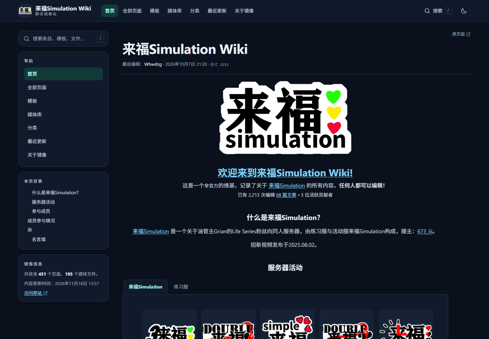
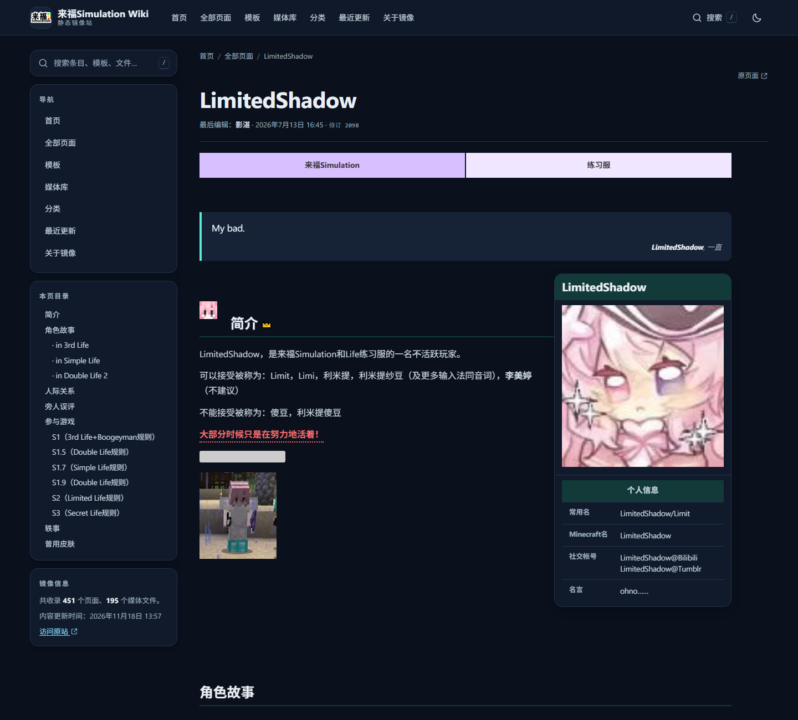

# 来福Simulation Wiki 静态镜像站

[来福Simulation Wiki](https://lifesimulation.fandom.com/zh/wiki/%E6%9D%A5%E7%A6%8FSimulation_Wiki) 的非官方静态镜像。GitHub Actions 每小时调用 MediaWiki API，抓取页面、模板、图片、音频和视频，生成可离线浏览、可搜索的静态站点并部署到 GitHub Pages。

<p align="center">
  <a href="https://whwdzg.github.io/Life-Simulation-Wiki/"><strong>在线访问 →</strong></a>
  &nbsp;·&nbsp;
  <a href="https://github.com/whwdzg/Life-Simulation-Wiki/actions/workflows/deploy-pages.yml">构建状态</a>
  &nbsp;·&nbsp;
  <a href="https://lifesimulation.fandom.com/zh/wiki/%E6%9D%A5%E7%A6%8FSimulation_Wiki">访问原站</a>
</p>

<p align="center">
  <a href="https://github.com/whwdzg/Life-Simulation-Wiki/actions/workflows/deploy-pages.yml">
    
  </a>
</p>

<p align="center">
  <a href="https://whwdzg.github.io/Life-Simulation-Wiki/">
    
  </a>
</p>

<p align="center"><sub>镜像站首页 · 浅色主题与 <code>Site-background-light</code> 页面背景 · 截图于 2026-11-18（UTC+8）· 内容更新时间显示在首页底部和全站页脚</sub></p>

## 概览

| 项目 | 说明 |
| --- | --- |
| 镜像范围 | 条目、用户、项目、文件、模板、分类、博客、模块、地图 |
| 页面数量 | 约 451 页（随源站变化） |
| 媒体文件 | 195 个原文件及页面缩略图，全部保存在本站 |
| 更新频率 | 每小时整点（`0 * * * *`，UTC） |
| 构建部署 | GitHub Actions → GitHub Pages |
| 搜索 | 浏览器本地全文搜索，无需第三方服务 |
| 模板 | MediaWiki 服务端展开 + 源站自定义 CSS |
| 许可 | 内容 CC BY-SA 3.0，代码 GPL-3.0 |

## 特性

- **模板真实渲染**：构建时调用 `action=parse`，由 MediaWiki 展开模板、解析器函数和页面链接。信息框、导航框、标签页等不是空的占位符，而是源站渲染后的 HTML。
- **自定义 CSS 同步**：每次构建读取 `MediaWiki:Common.css`、`MediaWiki:Wikia.css`、`MediaWiki:Mobile.css`，彩虹字、弹跳字、剧透黑幕、冰霜字、页签和头像悬停等效果都会保留。
- **图片与音视频离线化**：页面中的原图、不同尺寸缩略图、文件页预览、音频和视频全部下载到 `dist/media/`，构建完成后不再依赖 Fandom CDN。
- **增量媒体缓存**：`.cache/media` 通过 `actions/cache` 持久化，并以媒体清单签名作为缓存键；媒体没有变化时不会重复下载约 120 MB 内容。
- **完整的静态导航**：首页、全部页面、模板与模块、媒体库、分类、最近更新、同步统计、关于页面、404 和随机页面全部静态生成。
- **分类成员列表**：构建时通过 `list=categorymembers` 抓取每个分类的页面、子分类和文件，生成本地链接；空分类会显示明确提示。
- **页面评论（尽力抓取）**：尝试调用 Fandom `ArticleCommentsController` 获取条目评论、作者、时间与回复；源站未启用评论或接口返回空时，页面会显示空状态并链接到原站评论区。
- **站内搜索**：构建时生成 `data/search.json`，支持标题、摘要与正文搜索，键盘操作和移动端均可用。
- **主题背景同步**：构建时读取源站 `Site-background-light` / `Site-background-dark`，浅色和深色主题分别使用对应背景图，并叠加半透明内容面板保证可读性。
- **自适应与主题**：桌面/移动端响应式布局，支持浅色、深色主题并记住选择。
- **失败回退**：单页或单个媒体抓取失败不会中断构建；页面会保留错误提示或原站链接，并在下一次整点重试。

## 页面预览

<p align="center">
  
</p>

<p align="center"><sub>条目页示例：页面背景 · Portable Infobox · PageTabs · rainbow-text-hover · bounce-text · spoiler-blur</sub></p>

## 工作方式

```text
GitHub Actions（每小时整点）
  ├─ 读取 siteinfo / allpages / 最新修订 / 维基文本
  ├─ action=parse 渲染页面（模板、解析器函数在服务端展开）
  ├─ 读取 MediaWiki:Common.css / Wikia.css / Mobile.css
  ├─ 读取 Site-background-light / Site-background-dark 背景图
  ├─ 收集图片、缩略图、音视频 URL 并下载到 .cache/media
  ├─ 改写站内链接与媒体链接，生成 dist/ 静态站
  ├─ 生成搜索索引、sitemap、404 与统计信息
  └─ upload-pages-artifact → deploy-pages
```

构建流程的核心在 [`scripts/build.mjs`](scripts/build.mjs)；页面抓取、HTML 改写、媒体镜像和站点生成分别位于 [`src/lib/`](src/lib/)。

## 本地开发

要求 **Node.js 20+**，项目本身没有第三方依赖，因此不需要 `npm install`：

```powershell
npm run build     # 抓取源站并生成 dist/
npm run serve     # 本地预览 http://127.0.0.1:5173/
npm run check     # 校验内部链接、资源、更新时间与搜索索引
```

只调试页面结构、不想下载全部媒体时：

```powershell
$env:PAGE_LIMIT = '20'
$env:SKIP_MEDIA = '1'
npm run build
```

> 中国大陆网络环境通常需要代理。Node.js 需要显式读取代理变量：
>
> ```powershell
> $env:HTTPS_PROXY = 'http://127.0.0.1:7897'
> $env:HTTP_PROXY = 'http://127.0.0.1:7897'
> $env:NODE_USE_ENV_PROXY = '1'
> npm run build
> ```

### 配置项

| 变量 | 默认值 | 说明 |
| --- | --- | --- |
| `WIKI_API` | `https://lifesimulation.fandom.com/zh/api.php` | MediaWiki API 地址 |
| `SITE_BASE` | 空（站点根路径） | 部署在子路径时使用，例如 `/Life-Simulation-Wiki` |
| `SITE_ORIGIN` | `http://localhost:5173` | 用于 canonical、sitemap 的站点源 |
| `OUT_DIR` | `dist` | 输出目录 |
| `CACHE_DIR` | `.cache` | 媒体缓存目录 |
| `SYNC_CONCURRENCY` | `6` | 页面解析并发数 |
| `MEDIA_CONCURRENCY` | `8` | 媒体下载并发数 |
| `PAGE_LIMIT` | `0`（全部） | 仅抓取前 N 页，便于开发 |
| `SKIP_MEDIA` | `0` | 设为 `1` 时跳过媒体下载 |
| `WIKI_USER_AGENT` | 内置 UA | 覆盖请求源站时使用的 User-Agent |

## 部署到 GitHub Pages

1. 推送到 `main` 分支，或手动运行 **Actions → Build and deploy wiki mirror → Run workflow**。
2. 首次使用时，在仓库 **Settings → Pages → Build and deployment** 中将 **Source** 设为 **GitHub Actions**。
3. 工作流会读取 `actions/configure-pages` 的 `base_path` 和 `origin`，自动适配项目子路径（如 `https://<user>.github.io/Life-Simulation-Wiki/`）和自定义域名。
4. 定时任务为 `0 * * * *`（UTC）。GitHub 的 schedule 可能延迟数分钟到数十分钟，这是平台行为；首页显示的是实际抓取完成时间。

当前线上地址：<https://whwdzg.github.io/Life-Simulation-Wiki/>

## 目录结构

```text
.github/workflows/deploy-pages.yml   每小时构建与部署
docs/screenshots/                    README 预览截图
scripts/build.mjs                    构建入口
scripts/check.mjs                    产物校验
scripts/serve.mjs                    本地静态服务器
scripts/media-signature.mjs          媒体缓存签名
src/lib/api.mjs                      MediaWiki API 客户端（重试、POST、限流处理）
src/lib/collect.mjs                  页面、修订、模板、自定义 CSS、媒体索引抓取
src/lib/rewrite.mjs                  HTML 清洗、链接与媒体改写
src/lib/assets.mjs                   媒体下载、缓存、复制与回收
src/lib/layout.mjs                   页面外壳、导航、页脚、更新时间
src/lib/generate.mjs                 页面、索引、搜索、sitemap 生成
src/lib/links.mjs                    站内链接解析与特殊页面映射
src/lib/paths.mjs                    标题、路径、转义与 URL 工具
src/assets/style.css                 站点样式（MediaWiki/Fandom 组件）
src/assets/app.js                    搜索、标签页、折叠、灯箱、主题
src/assets/sw.js                     旧版 Service Worker 注销器
```

## 常见问题

**彩虹字 / 弹跳字为什么没有一直动？**

这些效果由源站 `MediaWiki:Common.css` 定义，其中 `rainbow-text-hover` 是悬停触发，`bounce-text` 是点击时弹跳，和原站行为一致。

**页面仍显示旧样式？**

镜像构建会为 CSS/JS 附加构建版本号，正常刷新即可。若之前访问过旧版 SPA，`/sw.js` 会自动清空旧缓存并注销旧 Service Worker，必要时再强制刷新一次。

**为什么有些特殊页面链接指向原站？**

最近更改、链入页面、用户贡献等依赖实时数据库的特殊页面不会逐页镜像；条目标题、文件页、模板、分类等常规内容均在本地。

## 已知限制

- 只读静态镜像：不提供编辑、评论、上传、登录。
- 动态变量、随机名言等保存的是构建时快照。
- 依赖实时数据库的特殊页面链接会回退到原站。
- 页面评论为尽力抓取：当前源站的 ArticleComments 接口返回空数据，因此条目页会显示“暂无评论/评论未启用”的空状态；接口恢复后无需改代码即可自动显示评论。
- 源站若启用验证码、Cloudflare 挑战或 API 限流，抓取可能失败；工作流不会覆盖上一次成功部署的站点。

## 许可与致谢

- 镜像页面与媒体来自来福Simulation Wiki，依 [CC BY-SA 3.0](https://creativecommons.org/licenses/by-sa/3.0/deed.zh-hans) 提供；本站不主张其版权。
- 本项目源代码以 [GNU General Public License v3.0](LICENSE) 发布。
- 本站为社区维护的非官方镜像，与 Fandom、来福Simulation 服务器管理组无隶属关系。
